<div align="center">


# Syn Wallet

**A non-custodial, phone-first, multi-chain crypto wallet that runs entirely in the browser.**
**Your keys never leave your device.**

[](LICENSE)


[Features](#features) · [Architecture](#architecture) · [Tech stack](#tech-stack) · [Security](#security-model) · [Getting started](#getting-started) · [Credits](#credits) · [License](#license)

</div>

---

Syn Wallet is a full-featured web wallet for Solana, Bitcoin, and 20+ EVM networks. Create or import a wallet from a single recovery phrase, hold and send assets across every chain, swap tokens, stake SOL, collect NFTs, trade perpetuals and prediction markets, and connect to dApps with WalletConnect — all from one mobile-first interface, with no account, no sign-up, and no server ever touching your keys.

<table>
<tr>
<td align="center"><strong>7</strong><br>chain families</td>
<td align="center"><strong>20+</strong><br>EVM networks</td>
<td align="center"><strong>600k</strong><br>PBKDF2 iterations</td>
<td align="center"><strong>0</strong><br>user data on the server</td>
</tr>
</table>

> [!IMPORTANT]
> **Local-only by design.** There is no account, no cloud backup, and no recovery service. Your encrypted vault lives only in your browser — if you lose your device and your recovery phrase, nobody can restore your wallet. That is the point.


---

## Features

<table>
<tr>
<th align="left" width="22%">Area</th>
<th align="left">What it does</th>
</tr>
<tr>
<td><strong>Wallet core</strong></td>
<td>Create a wallet with a 12-word BIP39 recovery phrase (numbered backup screen + verify-by-selecting-words), or import a 12/24-word phrase or a single-chain private key. One seed derives every chain (BIP44 / SLIP-0010): Solana, all EVM networks, Bitcoin SegWit and Taproot, plus Litecoin, Tron, XRP, Cosmos, Sui, and Aptos. Multiple wallets and accounts in one encrypted vault, per-wallet network visibility controls, custom networks and custom tokens.</td>
</tr>
<tr>
<td><strong>Portfolio</strong></td>
<td>Live total balance and per-asset balances with real USD prices; honest "unavailable" states — a price or balance is never faked. Live ticker charts (24H / 7D / 1M) with streaming price updates, an asset detail view, and multi-currency display with live FX rates. Activity history per network and across all networks, merged with locally recorded sends, with a transaction detail sheet and depth paging.</td>
</tr>
<tr>
<td><strong>Send &amp; receive</strong></td>
<td>Native sends on Solana, every EVM chain, and the UTXO family (BTC / LTC) with coin selection, fee estimation, and a review screen that always accounts for the network fee. Receive with per-chain addresses and QR codes; address book with counterparty memory.</td>
</tr>
<tr>
<td><strong>Swap</strong></td>
<td>In-wallet swaps via Jupiter (Solana) and LI.FI (EVM and cross-chain), with live quotes, price-impact display, and locally signed transactions.</td>
</tr>
<tr>
<td><strong>Invest</strong></td>
<td><strong>Crypto:</strong> trending DEX pools per network (GeckoTerminal) alongside your own holdings. <strong>Perpetuals:</strong> Hyperliquid markets (crypto, stocks, commodities, pre-IPO) with an in-wallet trading key that can trade but never withdraw, live charts, and position management. <strong>Prediction markets:</strong> Polymarket browsing with live streamed prices, Up-or-Down short-window markets with a real-time Chainlink price-to-beat ticker, positions, and order placement signed on-device. <strong>bStocks:</strong> tokenized U.S. stocks and ETFs on BNB Chain with live DEX prices. <strong>Stake:</strong> native Solana staking with validator discovery and identities.</td>
</tr>
<tr>
<td><strong>Collectibles</strong></td>
<td>NFT gallery across chains with collection views and on-device metadata rendering.</td>
</tr>
<tr>
<td><strong>dApps</strong></td>
<td>WalletConnect (Reown) pairing and request review — session proposals and signing requests queue in order and are approved or rejected on-device. Built-in Discover directory of dApps by category.</td>
</tr>
</table>

---

## Architecture

Syn Wallet is deliberately split into a **client that holds everything** and a **server that holds nothing**.

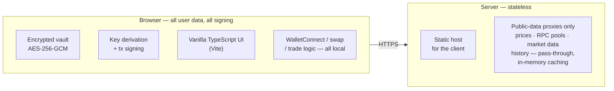

- The **client** (`client/`) is a dependency-light vanilla TypeScript app built with Vite. It generates and stores keys, derives addresses, builds and signs every transaction, and talks to swap/trading venues with the user's own credentials.
- The **server** (`src/server.ts`, Express) exists because browsers cannot reliably reach every upstream (CORS, rate limits, bot walls). It serves the client and proxies **public market data only** — prices, charts, RPC calls, order books, history — with bounded in-memory caches. It has no database, no accounts, no sessions, and never receives, logs, or stores a seed phrase, private key, or password.
- A small set of **build-time integrity tools** (`scripts/`) stamps each build with an ID and a release manifest, and verifies the served files against it.

---

## Tech stack

| Layer | Technology |
| --- | --- |
| Language | TypeScript (client + server) |
| Client build | Vite |
| Server | Node.js, Express, `ws` (WebSocket relay) |
| Key derivation | `@scure/bip39`, `@scure/bip32`, `@scure/btc-signer`, `@scure/base`, `@noble/curves`, `@noble/hashes` |
| Chains | `@solana/web3.js`, `@solana/spl-token`, `ethers` |
| dApp protocol | WalletConnect / Reown (`@walletconnect/sign-client`) |
| Swaps | Jupiter (Solana), LI.FI (EVM / cross-chain) |
| Markets | Polymarket (Gamma, CLOB, Data API, Relayer), Hyperliquid API |
| Prices & data | CoinGecko, GeckoTerminal, DexScreener, Blockscout, Routescan, Frankfurter (FX) |
| Typography | Allo (UI), DotGothic16 (dot-matrix amounts) |
| Icons | Remix Icon (self-hosted) |

---

## Security model

> [!WARNING]
> Syn Wallet is non-custodial: **you** are the custodian. Back up your recovery phrase offline, never share it, and never enter it anywhere except this wallet's own import screen.

- **Local-only, non-custodial.** All user data lives on the user's device: the encrypted vault, wallet metadata, and preferences in browser storage. The server stores nothing about any user — there is no cloud backup and no account to recover from. If a user loses their device and their recovery phrase, the wallet cannot be restored by anyone.
- **Vault encryption.** Secrets are encrypted at rest with **AES-256-GCM**; the encryption key is derived from the wallet password with **PBKDF2, 600,000 iterations** (WebCrypto, random salt and IV). Minimum password length is enforced; the vault auto-locks after inactivity, and revealing the recovery phrase requires password re-entry.
- **Signing stays on-device.** Every transaction — sends, swaps, Polymarket orders, Hyperliquid actions — is built and signed in the browser. Trading keys for Hyperliquid are generated on-device, stored only in the encrypted vault, and are trade-only (they cannot withdraw).
- **No tracking.** No analytics, telemetry, or error-reporting SDKs anywhere in the app; WalletConnect telemetry is explicitly disabled.
- **Constrained server surface.** Proxies are allowlisted and rate-limited; the Polymarket builder-signing helper is pinned to the single relayer operation the app performs; responses and caches are size-bounded.

---

## Getting started

Requirements: Node.js 20+ and npm.

```bash
npm ci          # install dependencies
npm run build   # build the client (Vite) and the server (tsc)
npm start       # serve the app
npm test        # run the full test suite
```

> [!NOTE]
> Optional operator keys can be supplied through environment variables for enhanced data sources (for example a Trust Wallet API key or RPC provider keys). The app runs without them on public endpoints; no key is ever sent to the browser.

---

## Project structure

<details>
<summary>Repository layout</summary>

```
client/            Browser app (vanilla TypeScript + CSS)
  main.ts          UI, screens, and flows
  style.css        Design system (dark charcoal, chrome/silver)
  lib/             Chain, wallet, market, and protocol modules
src/               Server
  server.ts        Express host + public-data proxies + WS relay
  tw.ts            Trust Wallet API client (server-side)
scripts/           Build stamping, integrity check, catalog tools
tests/             Derivation, vault, protocol, and audit test suites
proof/             Screenshots of the running app
```

</details>

---

## Credits

Syn Wallet stands on excellent open-source work and public APIs:

| Project | How it is used |
| --- | --- |
| **Trust Wallet** | The [Trust Wallet API](https://portal.trustwallet.com) (`tws.trustwallet.com`) is integrated server-side as an optional data source for address validation, asset status, and tickers. |
| **WalletConnect / Reown** | dApp pairing and session protocol (`@walletconnect/sign-client`, `@walletconnect/utils`). |
| **Jupiter** | Solana swap aggregation. |
| **LI.FI** | EVM and cross-chain swap routing. |
| **@scure** | `bip39`, `bip32`, `btc-signer`, `base` — audited key-derivation primitives. |
| **@noble** | `curves`, `hashes` — audited cryptography primitives. |
| **Solana** | `@solana/web3.js`, `@solana/spl-token` chain clients. |
| **ethers** | EVM chain client. |
| **Polymarket** | Gamma, CLOB, and Data APIs plus the Relayer, for prediction markets. |
| **Hyperliquid** | Perpetuals API. |
| **CoinGecko · GeckoTerminal · DexScreener** | Price and DEX market data. |
| **Blockscout · Routescan** | Transaction history data. |
| **Frankfurter** | FX rates for multi-currency display. |
| **validators.app** | Solana validator identities. |
| **Vite · Express · TypeScript · ws** | Build and runtime foundations. |
| **Allo** | Typeface by Josh Puckett (allo.joshpuckett.me) — the app's UI type system. |
| **DotGothic16** | Via Fontsource — dot-matrix display numerals. |
| **Remix Icon** | Every icon in the interface, self-hosted. |
| **uimaxx.ing** | Several Prediction-market card designs (mini market card, match card, event card, market detail) were adapted from its registry patterns and re-implemented natively. |

The interface is hand-built in vanilla TypeScript and CSS — no UI framework — following a native-iOS design language: large-title navigation, grouped inset cards, and a frosted tab bar.

---

## Screenshots

<p align="center">
    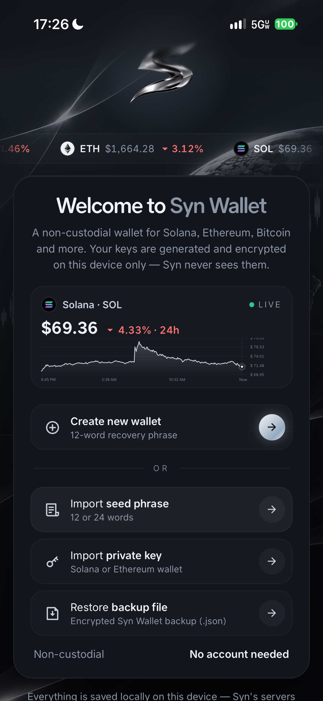
    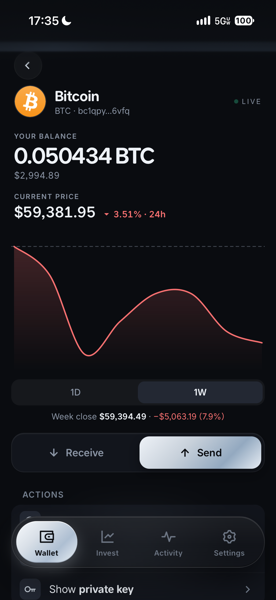
    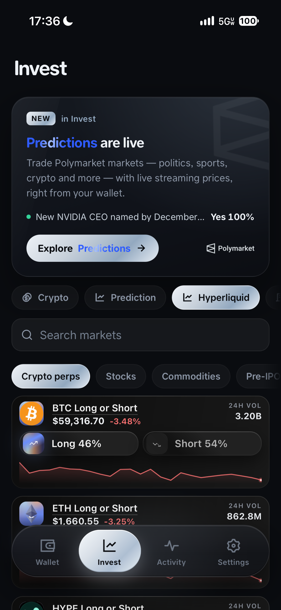
</p>
<p align="center">
    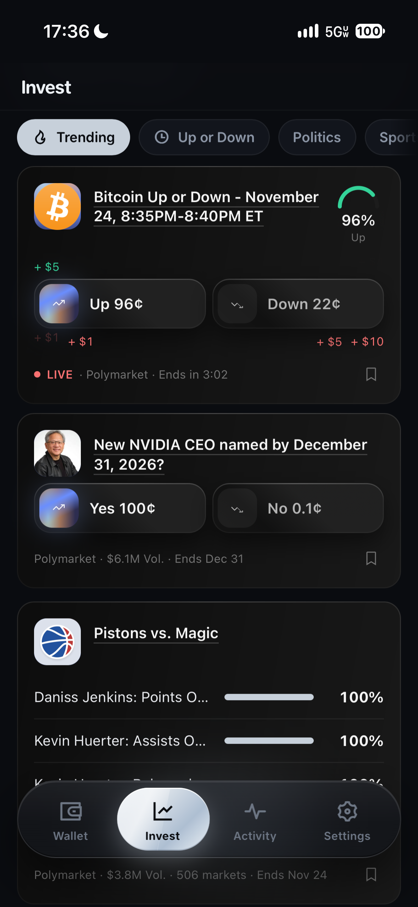
    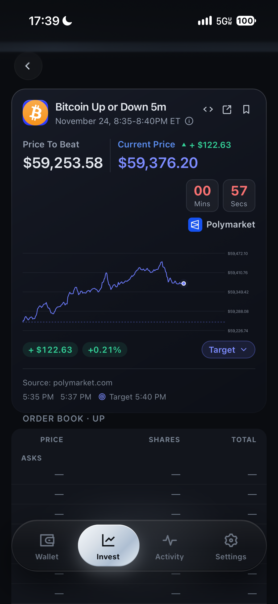
    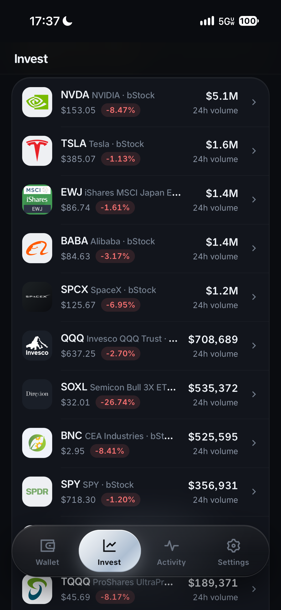
</p>
<p align="center">
    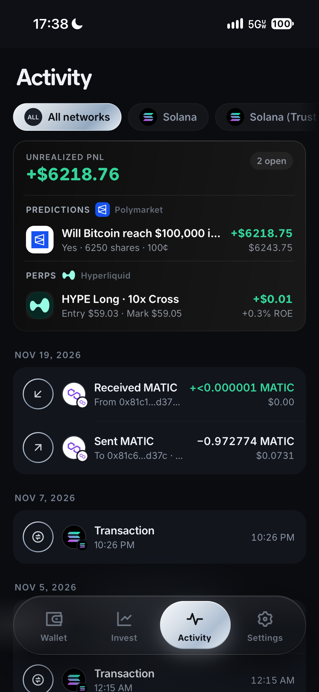
    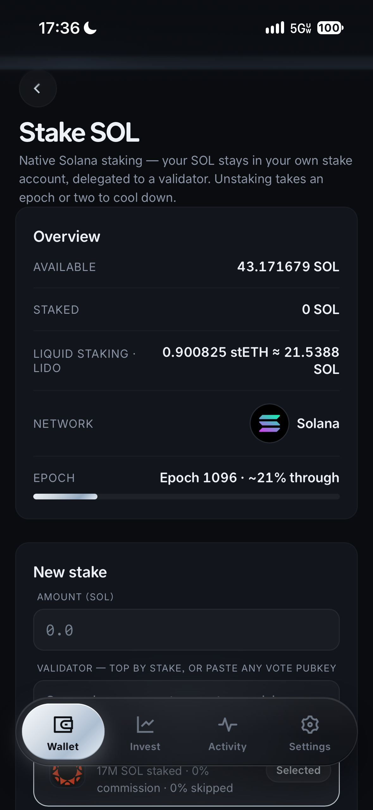
    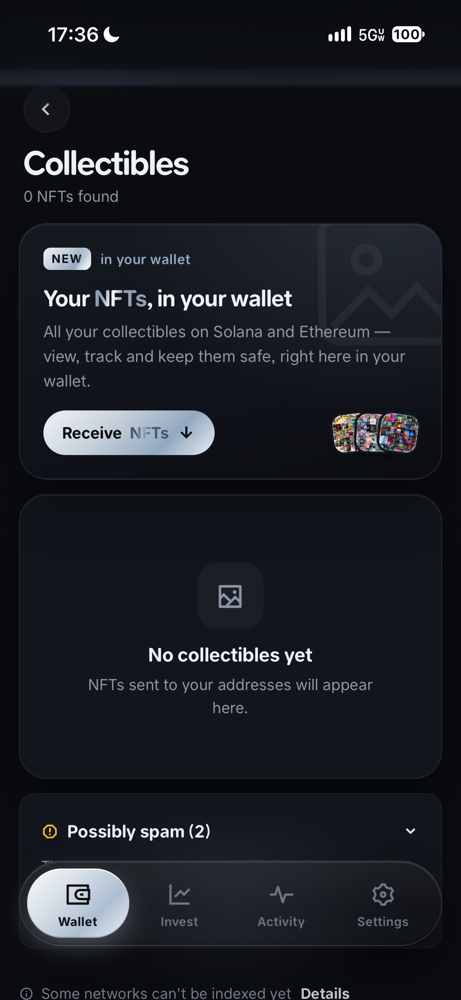
</p>
<p align="center">
    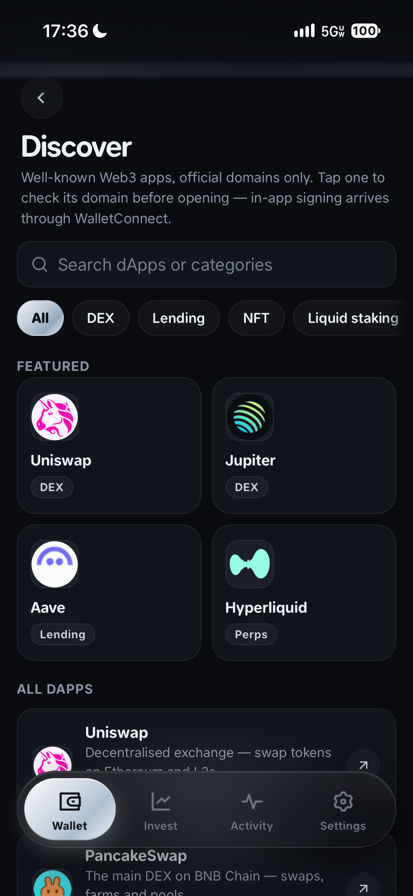
    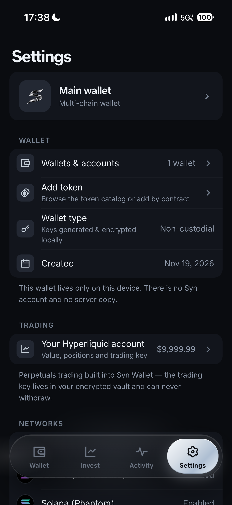
</p>

## License

Syn Wallet is released under the [GNU General Public License v3.0](LICENSE) (GPL-3.0).

Copyright (C) 2026 Syn — Syn Wallet.

In plain terms:

- **Copyleft.** Anyone may use, study, modify and share this software, but any distributed version — modified or not — must also be released under GPL-3.0, with its source code available.
- **Credit stays.** Copyright and license notices must be preserved; the original authors must be credited.
- **No warranty.** The software is provided "as is", without warranty of any kind (see the license text for the full terms).

See the full text in [LICENSE](LICENSE).

---

<div align="center">

**Syn Wallet** — built by **Syn**. One wallet, every chain, your keys only.

</div>
